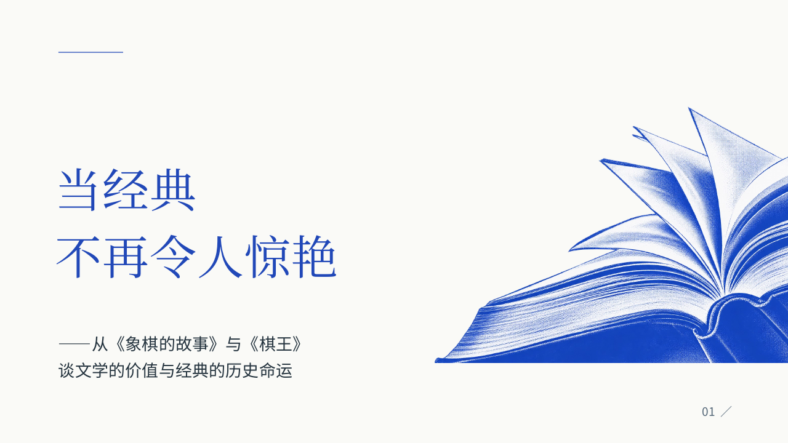
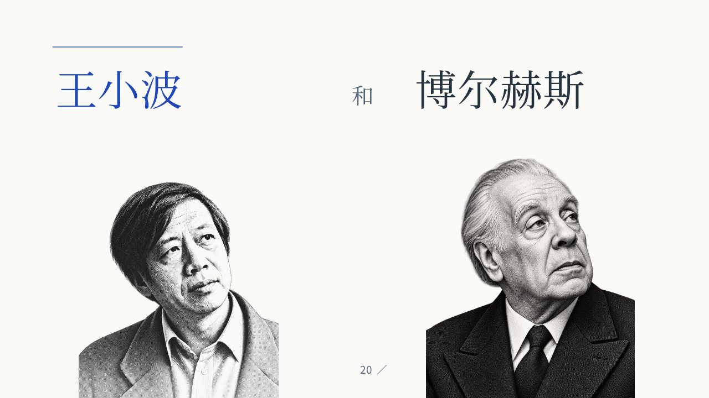

# 钴蓝人文演讲 PPT

平常让 AI 做 PPT，我总觉得有点“油腻”：标题像宣传口号，废话多，装饰也多，真正要讲的内容反而不够清楚。想要简洁一点，又经常被简化得只剩几个大词，整页空得没有重点。

所以，在 [mono-color skill](https://github.com/yanliudesign/mono-color-skill) 的帮助下，我反复调整了一套极简主义风格的演讲 PPT：纸白底、钴蓝色、宋体标题，配上单色网点插画、真实书封和作家照片，再用一些细线增加变化。

我自己觉得这一版比较好看，也比较适合文学、人文类的课堂演讲，就把它整理成了一个可以复用的 skill。下次换一份内容，也能继续沿用这套风格。

## 想保留的感觉

- **文字简洁，但有内容。** 保留具体例子、文本细节和必要的论证，少写空泛口号。
- **版式有留白，也有变化。** 有的页面居中，有的左对齐，按内容安排，不把每页都做成同一种模板。
- **图片和内容有关。** 作品用真实书封，作家用照片，概念页再搭配 mono 风格插画。
- **配色克制。** 以纸白、钴蓝和深灰为主，书封保留原有颜色。
- **可以继续修改。** 文字、姓名和表格都保留为可编辑对象。

这份示例围绕《象棋的故事》和《棋王》展开，共 35 页。新的演讲可以自行决定页数和结构，复用的是风格。

## 怎么用

将本仓库作为 Codex skill 安装到 `skills/cobalt-literary-slides`，然后输入：

> 使用 $cobalt-literary-slides，按以下新内容制作演讲 PPT，沿用已定稿的视觉风格。

接着附上自己的稿子。如果已经分好每页内容，可以直接按页提供；如果没有，就让 AI 根据演讲内容组织。

- [完整复用提示词](references/reuse-prompt.md)
- [Skill 说明](SKILL.md)
- [配色、字体与间距参数](references/design-system.json)
- [构图与内容规则](references/layouts.md)

## 看看成品

- [35 页可编辑 PPTX](assets/reference-deck.pptx)
- [PDF 预览](examples/final-deck.pdf)
- [更多页面预览](assets/previews/)

## 致谢与素材说明

感谢 [Yan Liu 的 mono-color skill](https://github.com/yanliudesign/mono-color-skill)，为这套 PPT 的限色、网点插画和留白处理提供了帮助。

示例中的书封、作家照片与文学内容用于这次演讲，素材来源见对应页备注。换主题时应重新选择相关素材；本仓库不对第三方书封和照片授予额外授权。
